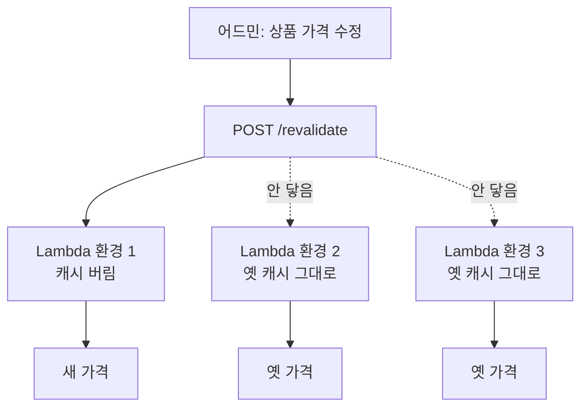
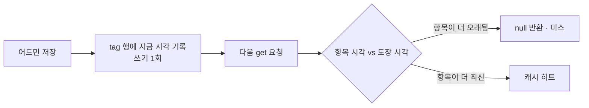

# **Next SSR 캐시를 Lambda 밖으로 꺼내기**
[메일 시스템 글]()에서 프론트를 React SPA 로 만들어 S3 에 올리고 CloudFront 로 서빙한다고 했다. 정적 파일이라 CDN 이 알아서 다 해줬고, 캐시 얘기는 `Cache-Control` 을 뭘로 줄지가 전부였다.

이번에 새로 만드는 몰은 SSR 이 필요했다. 상품 목록·상세가 검색에 걸려야 하는 B2B 쇼핑몰이라 빈 HTML 을 던지고 자바스크립트로 그리는 방식을 쓸 수 없었다. 그래서 Next 를 서버로 띄우기로 했는데, 그 서버를 Lambda 에 올리는 순간 SPA 때는 없던 문제가 하나 생겼다. **캐시가 여러 벌이 된다.**

## **왜 Lambda 인가 - 계산부터 했다**
SSR 을 올릴 자리는 셋이었다. Vercel, ECS Fargate, Lambda.

Vercel 은 처음부터 뺐다. 이 몰은 같은 계정의 RDS·S3·SES 를 쓰고 어드민도 같은 AWS 안에 있다. 렌더링 한 겹 때문에 프론트만 다른 클라우드로 보내면 그때부터 네트워크와 시크릿이 두 벌이 된다.

ECS 와 Lambda 는 숫자를 놓고 봤다. 트래픽 가정은 **일 3천 방문, 월 9만 페이지뷰**다.

| | 고정비/월 |
|---|---|
| ECS: ALB $16.4 + LCU $5 + Fargate(0.5vCPU/1GB) 2대 $41.4 + Redis $15 | **$78** |
| 위에 프라이빗 서브넷 NAT 까지 | **$121** |

Lambda 는 고정비가 0 이고 페이지뷰당 약 $0.0000042 다. 두 선이 만나는 지점을 구해보니 **월 1,880만 페이지뷰, 일 62만**이었다. NAT 를 낀 구성이면 일 97만이다.

사실상 안 온다. 일 62만 페이지뷰면 국내 중견 쇼핑몰 규모고, 그 지점에서는 Fargate 도 두 대로 안 되니 ECS 쪽 고정비가 같이 올라 교차점은 더 멀어진다. 우리 물량에서 SSR Lambda 는 **월 $0.17** 이다. 반올림하면 0 이다.

그래서 ECS 로 갈 이유는 비용이 아니라고 정리해뒀다. 15분 넘는 작업이 생기거나, 상시 연결이 필요하거나, 팀이 커져서 로컬과 운영이 같아야 할 때다.

Lambda 로 정하고 나면 Next 를 어떻게 올릴지가 또 갈린다. 길은 크게 둘이다.

- **OpenNext**: Next 를 Lambda 용으로 쪼개주는 표준 도구. ISR·이미지 최적화까지 지원한다. 대신 산출물이 server·image·revalidation 으로 여러 개로 갈린다
- **Lambda Web Adapter**: `output: 'standalone'` 으로 뽑아서 그냥 `node server.js` 로 띄우고, 어댑터가 Lambda 이벤트를 HTTP 로 바꿔준다

Lambda Web Adapter 로 갔다. 산출물이 zip 하나라 기존 API Lambda 배포와 모양이 같고, 이미지 최적화를 안 쓰니(우리 이미지는 S3 의 WebP 원본을 그대로 쓴다) OpenNext 의 이점이 크지 않았다.

결정적인 건 나중이었다. **OpenNext 는 Lambda 전용으로 산출물을 쪼개서 ECS 가 멀어진다.** Web Adapter 는 어댑터만 벗기면 같은 `node server.js` 가 컨테이너에서 돈다. 언젠가 옮길 수도 있다고 생각하면 이쪽이다.

## **Next 는 캐시를 네 겹으로 한다**
여기서부터가 본론이다. 먼저 Next 의 캐시가 몇 겹인지 정리하지 않으면 무엇을 옮기는 건지 말이 안 된다.

| 겹 | 어디 | 무엇 | 기간 |
|---|---|---|---|
| Request Memoization | 서버, 렌더 1회 | 같은 렌더 중 동일 fetch 중복 제거 | 요청 끝나면 소멸 |
| **Data Cache** | 서버, 요청·배포 넘어 | `fetch` 응답 | `revalidate` 로 지정 |
| Full Route Cache | 서버, 빌드 시 | 렌더된 HTML·RSC | 정적 라우트만 |
| Client Router Cache | 브라우저 | `<Link>` 이동용 RSC | 동적 0초 / 정적 300초 |

마지막 줄의 동적 0초는 Next 15 에서 바뀐 값이다. 그 전엔 30초였다.

**이 네 겹은 Cache Components 를 안 켠 경우의 이야기다.** Next 16 이 `cacheComponents: true` 와 `use cache` 를 들고 오면서 공식 문서에서 위 모델은 "이전 모델" 로 밀려났다. 우리는 이전 모델 위에 있다. 이유는 단순한데, 몰을 만들기 시작한 시점에 그게 기본이었고 지금 갈아탈 이유가 없어서다.

우리가 손대는 건 **Data Cache 한 겹**이다. 라우트가 전부 동적이라 Full Route Cache 는 해당이 없고, 나머지 둘은 끌 수도 없고 끌 이유도 없다.

한 가지 짚고 갈 게 있다. **Next 15 부터 `fetch` 는 기본이 캐시 안 함이다.** 예전 버전을 기억하고 "기본으로 캐시되니 꺼야지" 하고 들어가면 반대다. 캐시는 우리가 `revalidate` 를 적어서 켠 것이다.

## **기본 캐시는 그 프로세스의 파일시스템이다**
Data Cache 를 켜면 Next 가 어딘가에 응답을 저장한다. 그 어딘가가 기본값으로는 **그 프로세스의 파일시스템**(`.next/cache`)이다.

한 대짜리 서버면 아무 문제가 없다. Lambda 에서 문제가 된다.

Lambda 는 실행 환경이 여러 개다. 동시 요청이 셋이면 환경도 셋이고, 각자 자기 파일시스템에 캐시를 따로 쌓는다. 어드민이 상품 가격을 고치고 고객몰에 무효화를 쏘면 그 요청을 받은 **한 대만** 캐시를 버린다. 나머지는 TTL 이 끝날 때까지 옛 가격을 보여준다.

새로고침할 때마다 가격이 왔다 갔다 하는 그림이다. 실제로 그렇게 된다.

우리만 겪는 일도 아니다. 공식 문서가 같은 말을 해둔다 — *"한 인스턴스에서 `revalidateTag()` 를 부르면 그 인스턴스의 캐시만 무효화된다. 다른 인스턴스는 각자 알아챌 때까지 낡은 값을 계속 내보낸다."*

## **저장소를 DynamoDB 로 뺀다**
답은 단순하다. 캐시를 프로세스 밖 한 곳에 모으면 어느 대가 받든 전체에 반영된다. Next 는 `cacheHandler` 로 저장소를 갈아끼울 수 있게 열어뒀다.

**다만 지금 새로 시작한다면 먼저 볼 곳이 따로 있다.** Cache Components 의 `use cache: remote` 와 `cacheHandlers` 는 공유 저장소가 일급 기능이고 태그 동기화용 `refreshTags()` 까지 규격에 있다. 아래에서 우리가 손으로 짜는 걸 프레임워크가 해주는 셈이다.

저장소 후보를 또 놓고 봤다.

| 안 | 추가 비용/월 | 무효화 도달 |
|---|---|---|
| 현행 (공유 캐시 없음) | $0 | 인스턴스 1대 |
| **Lambda + DynamoDB** | **$1 미만** | **전체** |
| Lambda + ElastiCache | Redis $15 + NAT $43 = **$58~** | 전체 |
| Fargate 1대로 전환 | **$41** | 전체 (1대라서) |

Redis 를 쓰려면 Lambda 를 VPC 안에 넣어야 하고, 그러면 NAT 가 붙는다. 캐시 하나 때문에 월 $58 을 쓰는 건 이 규모에서 말이 안 된다. DynamoDB 는 계산해보니 월 $0.57 이었다.

재밌는 지점이 하나 있다. **DynamoDB 쓰기는 트래픽이 아니라 TTL 에 묶인다.** 캐시 미스는 항목이 만료될 때만 나므로 방문자가 열 배가 되어도 쓰기는 그대로다. 읽기만 트래픽에 비례하고 그 단가가 아주 낮다. 그래서 월 500만 페이지뷰까지 가도 DynamoDB 는 $11 언저리다.

구현은 클래스 하나다. 핸들러가 지켜야 할 건 `get` · `set` · `revalidateTag` · `resetRequestCache` 넷이고, 공식 문서의 self-hosting 문서에 예시가 있다.

~~~javascript
module.exports = class DynamoCacheHandler {
  async get(key, ctx = {}) {
    const res = await db().send(new GetCommand({ TableName: TABLE, Key: itemKey(key) }))
    const item = res.Item
    if (!item) return null

    const tags = [...new Set([...(item.tags ?? []), ...(ctx.tags ?? [])])]
    if (tags.length > 0) {
      const expiredAt = await this.#expiredAt(tags)      // 태그 도장 시각
      if (expiredAt > item.lastModified) return null     // 항목이 도장보다 오래됐다 → 미스
    }
    return { lastModified: item.lastModified, value: JSON.parse(item.value) }
  }
}
~~~

테이블은 하나고 키가 두 종류다. 항목은 `item#<키>`, 태그는 `tag#<태그이름>`.

## **무효화는 도장만 찍는다**
여기가 이 구현에서 제일 마음에 드는 부분이다.

캐시 무효화를 순진하게 짜면 "태그 X 가 붙은 항목을 전부 찾아서 지운다" 가 된다. 항목이 수천 개면 쓰기도 수천 번이다. DynamoDB 에서 이건 스캔이고, 느리고, 비싸다.

그래서 **지우지 않고 도장만 찍는다.**

`revalidateTag` 는 태그 행 하나에 현재 시각을 쓴다. 항목이 수천 개여도 **쓰기는 한 번**이다.

판정은 읽을 때 한다. `get` 이 항목을 꺼내고, 그 항목에 붙은 태그들의 도장 시각을 가져와서, **도장이 항목보다 나중이면 `null` 을 준다.** Next 는 그걸 미스로 보고 원본을 다시 부른다. 항목은 그대로 남아있지만 아무도 못 쓰는 상태가 되고, TTL 이 되면 알아서 사라진다.

무효화 비용이 항목 수와 무관해진다. 태그 하나에 상품 상세 3천 개가 걸려 있어도 어드민의 저장 한 번은 쓰기 한 번이다.

몇 가지 세부가 붙는다.

- **태그 조회는 요청 단위로 메모한다.** 홈 한 장에 캐시 항목이 6개인데 태그를 매번 읽으면 읽기가 6배가 된다. `resetRequestCache` 가 그 메모를 비우는 자리다
- **태그를 못 읽으면 "무효화 안 됨" 으로 본다.** 반대로 잡고 싶은 유혹이 있는데(안전하게 미스 처리), 그러면 DynamoDB 가 한 번 흔들릴 때마다 캐시가 통째로 날아가 DB 로 쏟아진다
- **저장소가 죽어도 `get`/`set` 은 그냥 미스로 넘긴다.** 캐시 때문에 화면이 안 나오면 안 된다
- **`cacheMaxMemorySize: 0`** 으로 인스턴스 안 메모리 캐시를 끈다. 안 끄면 그 층이 또 따로 놀아서 방금 고친 문제가 한 겹 위에서 반복된다

## **함정 1 - 캐시가 꺼진 채로 돌았는데 아무 에러가 없었다**
첫 배포는 초록불로 끝났다. 화면도 정상이었다. 그런데 DynamoDB 테이블 항목 수가 **0** 이었다.

원인은 이거였다.

~~~javascript
// next.config.mjs — 이렇게 짜면 안 된다
const sharedCache = process.env.CACHE_BACKEND === 'dynamodb'
...(sharedCache ? { cacheHandler: ..., cacheMaxMemorySize: 0 } : {})
~~~

`next.config.mjs` 는 **빌드 시점에 평가된다.** `next build` 가 도는 순간의 값이 산출물(`required-server-files.json`)에 굳는다. 그런데 나는 `CACHE_BACKEND` 를 Lambda 환경변수로 줬다. 이미 늦었다. 산출물에 핸들러가 아예 안 들어있는 상태로 배포된 것이다.

**증상이 없다는 게 제일 고약했다.** 에러도 경고도 없고, Next 기본 파일시스템 캐시로 멀쩡히 돈다. 화면은 나온다. 그냥 우리가 고치려던 원래 문제로 되돌아가 있을 뿐이다. 항목 수 0 이 유일한 단서였다.

고치는 방법은 둘이다. 빌드 스텝에 환경변수를 주거나, 아예 분기를 없애거나. 후자로 갔다.

~~~javascript
// 핸들러는 조건 없이 물린다
cacheHandler: join(import.meta.dirname, 'cache-handler.js'),
cacheMaxMemorySize: 0,
~~~

켜고 끄는 판단은 `cache-handler.js` 안에서 런타임 환경변수로 한다. 꺼져 있으면 `get` 이 바로 `null` 을 주고 SDK 를 아예 로드하지도 않는다.

빌드는 한 벌로 두고 동작만 런타임에 고르는 게 맞다. `next.config` 에서 분기하면 **같은 커밋이 어디서 빌드했느냐에 따라 다른 산출물**이 된다. 그건 나중에 반드시 사고가 된다.

확인하는 자리는 여기다.

~~~
.next/standalone/apps/shop/.next/required-server-files.json
  config.cacheHandler        '../cache-handler.js'   ← 있어야 한다
  config.cacheMaxMemorySize  0
~~~

여담인데, 윈도에서 빌드하면 이 경로가 역슬래시(`..\cache-handler.js`)로 굳어서 리눅스에서 깨진다. CI 산출물만 배포한다는 규칙이 이럴 때 쓰인다.

## **함정 2 - 캐시가 배포를 넘어 살아남았다**
상품 URL 을 `slug` 에서 번호로 바꾸는 배포를 했다. 배포 직후 목록의 링크가 전부 `/products/undefined` 가 됐다.

새 코드가 **옛 응답을 읽고 있었다.**

생각해보면 당연했다. Next 기본 캐시는 `.next/cache` 라 빌드할 때마다 새로 시작한다. 저장소를 밖으로 빼면서 **그 성질을 잃었다.** DynamoDB 는 배포를 몰라서, 같은 URL 이면 빌드가 달라도 같은 행을 본다. 캐시 저장소를 외부로 옮기는 일에 따라오는 대가인데 그걸 안 챙긴 것이다.

해결은 키 앞에 배포 식별자를 붙이는 것이다.

~~~javascript
// next.config.mjs — 빌드 때 박고
deploymentId: process.env.GITHUB_SHA || String(Date.now()),

// cache-handler.js — 런타임에 읽는다
const NS = process.env.NEXT_DEPLOYMENT_ID || ''
const itemKey = (key) => ({ pk: `item#${NS}#${key}` })
~~~

런타임에 빌드를 알아내는 길을 찾는 데 시간을 좀 썼다. 핸들러 생성자가 받는 `serverDistDir` 은 **네 번 중 한 번 `undefined`** 로 왔고, `__dirname` 은 Turbopack 이 번들한 사본에서 `/ROOT/` 였다. 둘 다 로컬에선 멀쩡해 보이다가 운영에서 조용히 빈 값이 되는 종류다. 결국 환경변수만 프로세스 전체에서 일정했다.

**태그 키에는 네임스페이스를 안 붙였다.** 항목만 붙인다. 도장의 뜻이 "이 시각 이후로 이 태그는 낡았다" 이고 그건 빌드와 무관해서다. 태그까지 가르면 배포 직전에 찍힌 무효화를 새 빌드가 못 보고 옛 값을 되살린다.

## **로컬에서도 켜본다**
커스텀 캐시 핸들러는 **예외 없이 티 안 나게 틀리는 종류의 코드**다. 옛 값을 주거나, 남의 값을 주거나. 둘 다 에러가 안 난다.

그래서 평소 개발은 캐시를 끄되, 켜서 확인할 수단을 같이 만들었다.

~~~bash
npm run dev            # 평소. TTL 0 이라 캐시 자체가 없다
npm run dev:cached     # dynamodb-local 컨테이너 + 운영과 같은 TTL
~~~

평소에 끄는 이유가 있다. 어드민에서 고쳐놓고 새로고침했는데 그대로면 **코드를 의심하게 된다.** 캐시 때문이라는 걸 깨닫는 데 걸리는 시간이 아깝다.

대신 올리기 전에는 `dev:cached` 로 한 번 돌려본다. postgres 를 로컬 docker / 운영 RDS 로 쓰는 것과 같은 구조다. 운영에서 처음 돌게 두지 않는다.

한 가지 더. Data Cache 의 키는 **URL 과 옵션**이다. 토큰은 키에 안 들어간다. 로그인이 필요한 요청을 캐시되는 함수로 보내면 A 손님 응답이 B 손님에게 나간다. 그래서 개인화 응답을 부르는 함수는 **캐시 옵션을 아예 받지 않게** 만들었다.

~~~typescript
// 캐시 옵션 자체를 받지 않는다. revalidate: 0 을 적어주는 규율에 기대면
// 언젠가 한 곳에서 빠지고, 그 한 곳이 남의 장바구니를 보여준다
export async function serverGetPrivate<T>(path: string, token: string): Promise<T> {
  const res = await fetch(`${SERVER_ORIGIN}${path}`, {
    cache: 'no-store',
    headers: { authorization: `Bearer ${token}` },
  })
  ...
}
~~~

같은 이유로 HTML 자체는 CloudFront 에 캐시하지 않는다. 캐시하려면 몰 쿠키와 세션 쿠키를 캐시 키에 넣어야 하는데, 그 설계를 한 번이라도 틀리면 한 사람의 화면이 CDN 에 박혀 모두에게 나간다. 우리 물량에서 SSR Lambda 가 월 $0.17 인데 그 위험을 살 이유가 없었다.

## **정리**
- SSR 을 Lambda 에 올리면 **캐시가 실행 환경 수만큼 생긴다.** 무효화는 그중 한 대에만 닿고, 나머지는 TTL 이 끝날 때까지 옛 값을 준다
- Next 캐시는 네 겹이고 우리가 옮기는 건 Data Cache 한 겹이다. Next 15 부터 `fetch` 는 **기본이 캐시 안 함**이다. 단 이 네 겹은 Cache Components 를 안 켠 이전 모델 기준이다
- 저장소를 DynamoDB 로 빼면 월 $1 미만이다. Redis 는 Lambda 를 VPC 에 넣어야 해서 NAT 까지 $58 이 붙는다
- 무효화는 **태그에 도장만 찍는다.** 항목을 지우지 않고, `get` 이 항목 시각과 도장 시각을 비교해 판정한다. 항목이 수천 개여도 쓰기는 한 번
- 캐시 저장소를 잃어도 화면은 나와야 한다. `get`/`set` 실패는 미스로 넘기고, 태그를 못 읽으면 "무효화 안 됨" 쪽으로 넘어진다
- `next.config` 는 **빌드 시점에 평가된다.** 거기서 환경변수로 분기하면 Lambda 환경변수로는 못 고친다. 에러 없이 캐시가 꺼진 채 돈다
- 캐시를 프로세스 밖으로 빼면 **배포마다 새로 시작하던 성질을 잃는다.** 키에 배포 식별자를 붙인다. 단 태그 키에는 붙이지 않는다
- 커스텀 캐시 핸들러는 티 안 나게 틀린다. **켜서 확인할 수단을 같이 만든다**

정리하고 보니 이 글의 절반이 "에러가 안 나는 고장" 얘기다. 캐시가 꺼진 채 돈 것도, 새 코드가 옛 응답을 읽은 것도 화면은 멀쩡했다. 로그를 봐도 안 나오고 테이블 항목 수 같은 엉뚱한 데서 드러났다. 캐시를 직접 짜면 그 대가로 이런 걸 얻는 것 같다. 다음에 또 이런 걸 만든다면, 만들기 전에 "틀렸을 때 뭘 보면 아나" 부터 정해두려고 한다.
