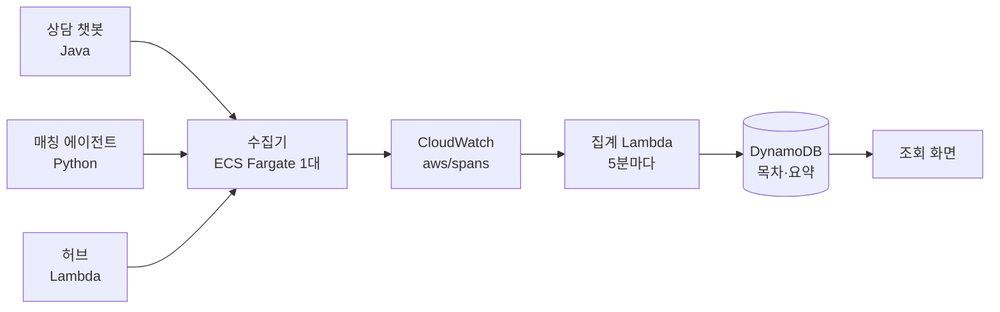
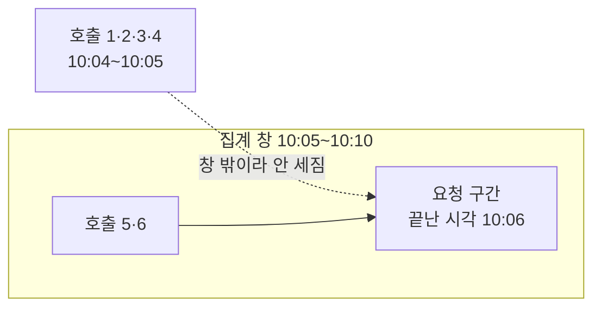

# **LLM 추적을 OpenTelemetry 로 모으기**
[RAG 챗봇]()을 만들고, [검색 품질을 끌어올리고](), [여러 모델이 역할을 나눠 협업하게]()까지 했다. 그런데 운영에 올려놓고 보니 "답이 왜 이렇게 나왔나" 를 확인하는 게 매번 고역이었다.

질문 하나가 들어오면 재작성·임베딩·검색·재정렬·판정·작성·검수를 거친다. 어느 단계에서 뭘 가져왔고, 어디서 시간을 썼고, 토큰이 얼마나 나갔는지를 보려면 DB 테이블 두 개와 애플리케이션 로그를 번갈아 봐야 했다. 그마저도 우리 앱 얘기고, 옆 팀의 매칭 에이전트는 공개된 Phoenix 서버에 기록을 쌓고 있었다. 인증도 없고 백업도 없는 EC2 한 대에, SQLite 파일로 쌓고 있었다.

앱이 늘수록 저장 방식도 늘고, 언어가 다르면 처음부터 다시 만든다. 그래서 **기록 형식은 OpenTelemetry 하나로, 받는 곳은 수집기 하나로** 모으기로 했다. 이 글은 그 기록이다.

## **OpenTelemetry 는 AI 도구가 아니다**
먼저 짚어둘 게 있다. OpenTelemetry 는 **LLM 용으로 만들어진 게 아니다.** 웹 요청·DB 조회 같은 걸 기록하려고 만든 관측 표준이고, 생성형 AI 는 거기 나중에 붙은 한 갈래다.

다루는 신호가 넷(트레이스·메트릭·로그·배기지)인데 우리가 쓰는 건 트레이스 하나다. 메트릭은 수집기에 경로를 아직 안 뚫었고(필요한 것만 골라 나중에), 로그는 이미 CloudWatch 로 가고 있어서 굳이 옮길 이유가 없었다. 배기지는 애초에 관측용이 아니라 값을 하위 서비스로 실어 나르는 장치다. 이 글도 트레이스 얘기다.

하나만 더. 속성 이름을 제멋대로 짓지 말라고 OpenTelemetry 가 사전을 준다. 시맨틱 규약이라고 하는데 HTTP·DB·메시징이 각각 있고, 우리가 쓴 `gen_ai.*` 가 그중 생성형 AI 편이다. 이게 뒤에서 한 번 더 나온다.

그럼 왜 LLM 전용 도구를 안 쓰고 이쪽으로 갔나. Langfuse·Phoenix·LangSmith 같은 것들은 전부 **보내는 쪽 코드를 그 도구에 맞춰 짜게** 만든다. 나중에 도구를 바꾸면 앱을 전부 손봐야 한다. 앱이 하나면 상관없는데 우리는 자바·파이썬·Lambda 에 다른 클라우드까지 섞여 있었다.

OpenTelemetry 는 반대다. 앱은 "이런 일이 있었다" 를 표준 형식으로 보내기만 하고, 어디에 어떻게 저장할지는 받는 쪽에서 정한다.

붙이는 것 자체는 환경변수 세 개로 끝난다.

~~~bash
OTEL_SERVICE_NAME=<앱이름>
OTEL_EXPORTER_OTLP_ENDPOINT=https://otel.example.com
OTEL_EXPORTER_OTLP_HEADERS=Authorization=Bearer <토큰>
~~~

보내는 경로는 언어를 안 탄다. Phoenix 를 쓰던 파이썬 앱은 보낼 주소와 헤더만 바꿔 끼웠고, Spring Boot 는 의존성 두 줄로 끝났다. 거기에 더해 Spring AI 가 모델 호출 구간을 알아서 남겨준다 — 모델 이름, 토큰 수, 소요 시간이 코드 한 줄 없이 붙는다.

다만 여기까지가 "붙는다" 까지다. 쓸 만한 기록이 되기까지 앱에서 손본 게 네 군데 더 있었다.

## **수집기는 코드가 없다**
받는 쪽은 OpenTelemetry Collector 의 contrib 배포판을 그대로 쓴다. 우리가 만든 건 설정 파일 하나다. **nginx 를 짜지 않고 `nginx.conf` 만 쓰는 것과 같다.**

설정에서 한 일은 둘이다. 들어오는 걸 확인하고, 나가는 걸 서명한다.

~~~yaml
extensions:
  # 앱별 Bearer 토큰 확인. 목록에 없으면 401
  bearertokenauth/in:
    scheme: Bearer
    tokens: ${env:OTEL_TOKENS}

  # 내보낼 때 태스크 역할로 SigV4 서명
  sigv4auth/xray:
    region: ap-northeast-2
    service: xray
~~~

둘 다 contrib 배포판에 들어있어서 **인증을 직접 짤 일이 없다.** 앱은 토큰만 들고 HTTPS 로 쏘고, 수집기가 AWS 자격증명으로 바꿔 서명해 보낸다. 앱에 AWS 키를 심지 않아도 되는 게 이 구조의 핵심이다 — 다른 클라우드에 있는 앱도 똑같이 붙는다.

사실 이건 고른 게 아니라 거의 강제다. AWS 의 OTLP 엔드포인트는 **트레이스에 SigV4 서명을 요구한다**(메트릭·로그는 베어러 토큰도 받는다). 앱마다 AWS 자격증명을 쥐여주기 싫으면 중간에 서명해줄 무언가가 있어야 한다.

토큰은 Parameter Store 에 JSON 배열 하나로 두고, 추가·폐기할 때 앱은 재배포하지 않는다. 수집기만 롤링 재시작한다.

앱 쪽 전송은 비동기 묶음이라 수집기가 죽거나 느려도 앱은 기록만 버리고 계속 돈다. 고객 응답이 늦어지지 않는다.

수집기를 Lambda 가 아니라 ECS 로 올린 건 묶음 전송 때문이다. OTLP 수신은 열려 있는 동안 계속 받아 모았다가 한 번에 내보내는 구조라 요청 단위로 죽는 Lambda 와 안 맞는다.

월 비용은 이렇게 나뉜다. 원문까지 담아 월 10GB 를 보낸다고 잡은 값이다.

| 항목 | 월 | 단가 |
|---|---|---|
| 수집기 Fargate 0.25 vCPU 1대 | 약 $9 | |
| 트레이스 적재 | 약 $3.5 | $0.35/GB |
| 1년 보관 | $0.3 (연말에 약 $3.6) | |
| NAT 통과 | 약 $1 | $0.045/GB |
| 조회 (집계 + 상세) | $1 미만 | |
| 집계 Lambda · 스케줄 · DynamoDB | $1 미만 | |
| ALB · 토큰·설정 저장 · 인덱싱 1% | $0 | |
| | **약 $15~20** | |

**절반 이상이 받는 비용이 아니라 수집기를 띄워두는 비용**이다. 기록이 열 배로 늘어도 $9 는 그대로다. ALB 가 $0 인 건 기존 것에 호스트 규칙만 얹어서고, 새로 만들었으면 여기만 월 $16 이 붙는다. 수집기가 프라이빗 서브넷에 있어서 나가는 건 전부 NAT 를 탄다 — 지금은 $1 이지만 양에 비례해 는다.

## **켜자마자 헬스체크가 답변보다 많았다**
첫 배포 날 기록을 보니 이상했다. 답변 기록보다 **헬스체크가 몇 배 많았다.**

Spring Boot 는 트레이싱이 켜지면 HTTP 요청·예약 작업·보안 필터를 자동으로 구간으로 만든다. 서비스 네 개가 30초마다 서로 헬스체크를 하고 알림 폴링까지 도니, 정작 보려던 답변 파이프라인이 그 사이에 묻혔다.

처음엔 끌 것을 하나씩 나열하려다 그만뒀다. **차단 목록은 라이브러리를 올릴 때마다 새 자동 기록이 또 샌다.** 반대로 갔다.

~~~java
// 트레이스로 보내는 구간을 AI 관련만 남긴다(허용 목록)
static final List<String> ALLOWED_PREFIXES = List.of("chatbot.", "gen_ai.", "spring.ai.");

@Bean
ObservationPredicate aiObservationsOnly() {
    return (name, context) -> isAllowed(name) || isChatRequest(name, context);
}
~~~

우리 단계 구간(`chatbot.*`), Spring AI 가 만드는 모델·임베딩 호출(`gen_ai.*`), 도구 호출(`spring.ai.*`). 이 셋만 통과시킨다.

`|| isChatRequest` 가 예외 통로다. 답변이 나간 뒤에 도는 분류기 같은 것들을 한 트레이스로 묶으려면 그 부모가 되는 HTTP 요청 구간이 있어야 하는데, 그건 세 접두사 중 어디에도 안 걸린다. 그래서 메서드와 경로가 정확히 일치하는 대화 요청만 따로 살린다. 앞부분 일치로 두면 나중에 생기는 다른 경로까지 새어 든다.

그리고 수집기에서 한 번 더 거른다.

~~~yaml
filter/ai_only:
  traces:
    span:
      # LLM 아닌 AWS 호출 (S3·DynamoDB 등)
      - 'attributes["rpc.system"] == "aws-api" and attributes["gen_ai.operation.name"] == nil'
      # 들어오는 HTTP 요청 — 살려둔 대화 요청만 ops.keep 으로 뺀다
      - 'kind.string == "Server" and attributes["gen_ai.operation.name"] == nil and attributes["ops.keep"] != "true"'
~~~

조건에 걸리면 버려진다. 살린 대화 요청 구간에는 앱이 `ops.keep=true` 를 붙여 둬서 이 그물을 빠져나간다. (이 `traces.span` 표기는 폐기 예정이다. 새 버전은 `trace_conditions` 에 `span.` 접두를 붙인 형태를 쓴다.)

두 겹인 게 과해 보이는데, 붙이는 앱마다 자동 계측이 만드는 게 다르다. 파이썬·Node 의 AWS SDK 계측은 Bedrock 말고 S3·DynamoDB 호출까지 전부 구간으로 만든다. **앱 쪽은 각자 알아서 하게 두고, 수집기는 공통 안전망으로 둔다.**

## **스트리밍에서 캐시 토큰이 0 이 됐다**
기록이 쌓이기 시작하자 숫자가 안 맞았다. DB 에는 캐시 읽기 **6,964** 로 적힌 호출이 트레이스에는 **0** 이었다.

범인은 스트리밍이었다. Spring AI 는 스트리밍 조각을 모아 응답을 다시 만드는데(`MessageAggregator`), 그 과정에서 사용량을 입력·출력·합계 세 숫자로만 새로 만든다. 캐시 값은 거기서 버려진다. 모은 응답만 보는 트레이스 필터는 당연히 0 을 적었다.

고친 방법은 원본 조각이 지나가는 자리에서 값을 챙겨두는 거다.

~~~java
// 원본 조각을 보는 여기서 값을 요청 메시지 metadata 에 적어 두면,
// 구간이 닫힐 때(조각 처리 뒤) 필터가 읽는다
private void stashCacheForTrace(Prompt prompt, ChatResponse chunk) {
    if (chunk.getMetadata() == null || chunk.getMetadata().getUsage() == null) {
        return;                                 // 사용량이 실린 조각에서만 덮어쓴다
    }
    var cache = this.cacheTokens(chunk.getMetadata());
    var metadata = prompt.getUserMessage().getMetadata();
    metadata.put(TRACE_CACHE_READ, cache[0]);
    metadata.put(TRACE_CACHE_WRITE, cache[1]);
}
~~~

여기서 배운 게 하나 있다. **자동 계측은 라이브러리가 "정상" 이라고 보는 경로만 지난다.** 스트리밍처럼 중간에 모양이 바뀌는 길에서는 값이 소리 없이 빠진다. 에러가 안 나니 숫자를 따로 대조해보기 전엔 모른다.

같은 문제가 토큰 정의에도 있었다. 표준은 `gen_ai.usage.input_tokens` 에 캐시 토큰을 포함하라고 정하는데, Bedrock 은 캐시를 뺀 값을 준다. 그대로 두면 캐시를 많이 쓸수록 입력 토큰이 작아 보인다. 캐시 읽기·쓰기를 더해 표준 의미로 덮어쓰고, 캐시 값은 표준 이름으로 따로 남겼다.

## **표준 이름을 쓰면 생기는 일**
속성 이름은 OpenTelemetry 의 생성형 AI 규약(`gen_ai.*`)을 따랐다. 처음엔 우리 이름을 쓰다가 표준과 대조하면서 빈칸을 메웠는데, 생각보다 많이 정해져 있었다.

| 우리가 필요했던 것 | 표준 이름 |
|---|---|
| 첫 조각까지 걸린 시간 | `gen_ai.response.time_to_first_chunk` |
| 캐시 읽기·쓰기 | `gen_ai.usage.cache_read.input_tokens` · `cache_write.input_tokens` |
| 대화 번호 | `gen_ai.conversation.id` |
| 임베딩 차원 | `gen_ai.embeddings.dimension.count` |
| 검색 후보 수 | `gen_ai.retrieval.top_k` |

표준에 있는 이름을 쓰면 **나중에 다른 도구를 붙일 때 변환 규칙을 안 짜도 된다.** 실제로 옆 팀 앱이 OpenInference 이름(`llm.input_messages`)을 쓰고 있어서, 그건 수집기에서 바꿔주거나 앱을 고쳐야 할 숙제로 남아 있다. 전송 경로는 언어를 안 타는데 속성 이름은 아직 각자다.

찾는 것부터 함정이 하나 있다. 생성형 AI 규약은 본체 저장소에서 떨어져 나갔다. 예전 레지스트리 페이지에는 이전 안내만 남아 있어서, 거기서 확인하면 `gen_ai.retrieval.top_k` 같은 건 "없는 이름" 으로 보인다.

구현이 규약을 못 따라오기도 한다. Spring AI 는 캐시 쓰기를 `cache_creation` 이라는 옛 이름으로 내보내서, 표준에 맞추려면 결국 덮어써야 한다.

표준이 못 채워준 것도 있었다. Bedrock 이 추론 토큰을 따로 안 줘서 `gen_ai.usage.reasoning.output_tokens` 는 비워뒀다.

그리고 **원문을 남기면 크기 제한에 걸린다.** 프롬프트와 응답을 `gen_ai.input.messages`·`output.messages` 에 넣었는데, AWS 의 OTLP 엔드포인트는 구간 하나가 200KB 를 넘으면 그 구간을 거절한다. 한글은 글자당 3바이트라 생각보다 금방 찬다.

짚고 갈 게 있다. 표준은 이 두 속성을 **Opt-In 으로 둔다.** 기본이 꺼져 있는 데는 이유가 있는데, 사용자가 친 질문이 그대로 들어가고 거기 개인정보가 섞인다. 우리는 그걸 켠 쪽이고, 켠 이상 보관 기간과 누가 볼 수 있는지를 같이 정해야 한다. 크기 제한은 그다음 문제다.

그래서 원문 합이 180KB 를 넘을 때만 가장 긴 메시지의 **가운데를 줄인다.** 앞뒤를 남기는 건 질문의 시작과 답의 끝이 보통 더 중요해서다. 표준 환경변수(`OTEL_ATTRIBUTE_VALUE_LENGTH_LIMIT`)로 길이를 막는 방법도 있는데, 스펙이 **어느 쪽을 자를지는 안 정해놨다.** 구현에 맡기면 질문 앞이 날아갈지 답 뒤가 날아갈지 모른다.

## **5분마다 집계했더니 호출이 빠졌다**
CloudWatch 에 원문째로 쌓아두고, 목록과 차트에 쓸 요약은 Lambda 가 5분마다 만들어 DynamoDB 에 넣는다. 매번 원본을 훑으면 조회비가 나가서다.

그런데 요청별 모델 호출 수가 이상하게 작게 나왔다. 실측해보니 **6회 호출한 요청이 2회로 잡혀 있었다.**

스트림을 창으로 자를 때 생기는 전형적인 문제였다. 요청 구간은 끝난 시각으로 기록된다. 요청이 10:04 에 시작해 10:06 에 끝났고 창이 10:05~10:10 이면, 요청은 창 안에 들어오는데 10:05 이전에 일어난 모델 호출은 창 밖이다.

고친 건 질의 한 줄이다. 모델 호출은 창보다 더 앞에서부터 읽는다.

~~~python
LOOKBACK = timedelta(minutes=10)   # 늦게 도착한 것까지 다시 읽는 폭
SETTLE   = timedelta(minutes=2)    # 막 들어오는 중인 구간은 다음 실행에
LLM_PAD  = timedelta(minutes=10)   # 모델 호출은 이만큼 더 앞부터

start = cursor - LOOKBACK
end   = now - SETTLE

llm_f = pool.submit(_query, LLM_QUERY, start - LLM_PAD, end + LOOKBACK)
~~~

세 숫자가 각각 다른 문제를 막는다. `LOOKBACK` 은 지난 창에 늦게 도착한 것, `SETTLE` 은 아직 들어오는 중인 것, `LLM_PAD` 는 창 시작에 걸친 요청의 앞부분. **창을 쓰는 집계는 경계마다 새는 구멍이 따로 있다**는 걸 이때 알았다.

## **뭘 안 모을지도 정해야 한다**
그럼 AI 말고 나머지도 다 모으면 되지 않나 싶었는데, 재보고 접었다.

최근 30일 요청 수를 네 계정에서 실제로 세어보니 **월 1억 7,700만 건**이었다. 요청 하나가 DB 조회 같은 기록 5~20개를 만들고 합쳐 약 10KB 라고 보면 월 1.8TB 다. CloudWatch 적재비가 비싸다는 건 [예전 글]()에서도 한 번 짚었는데, 이번엔 그 숫자를 실제로 대입해봤다.

| | 월 비용 |
|---|---|
| 전부 받기 | 적재 87만 + 보관 90만 + 수집기·계정 간 전송 → 1년 뒤 **200만 원대** |
| 1% 만 받고 오류는 전부 | 약 2만 원 |
| AI 관련만 (지금) | 약 2만 원대 ($15~20) |

여기서 솔직히 적자면, **AI 전용이 1% 샘플링보다 싼 게 아니다.** 둘이 비슷하다. 고른 이유는 돈이 아니라, 1% 로 긁어모은 잡다한 기록은 볼 사람이 정해지기 전엔 쌓이기만 해서다.

덧붙여 LLM 쪽은 **샘플링으로 줄이기도 어렵다.** "이 답변이 왜 이러냐" 는 문의가 들어왔을 때 그 한 건이 샘플에 없으면 끝이라 100% 받는다. 그리고 모델 호출 구간은 원문을 담아 수십~수백 KB 다 — 일반 HTTP 구간이 1KB 안팎인 걸 생각하면, 적재비가 요청 수가 아니라 **원문 길이에 붙는다.**

더 결정적인 건 따로 있었다. AI 요청 안의 DB 조회도 안 넣기로 했는데, 실측 때문이다. 답변 하나가 중앙값 **12.5초** 걸리는데 그중 모델·임베딩·재정렬이 **98%** 였다. 코드와 DB 를 전부 합쳐 요청당 약 0.2초다.

중앙값 기준으로는 DB 를 쪼개 봐도 "어디가 느린가" 의 답이 안 바뀐다. 꼬리 쪽은 다르겠지만 그건 RDS 성능 분석이 훨씬 잘 보여준다. 단계마다 "모델 외 시간" 은 지금 화면에서도 보이니, 그게 커지는 날 그 단계만 들여다보면 된다.

AI 쪽에서 의미 있는 건 DB 에 걸린 시간이 아니라 무엇을 가져왔나다. 자료 후보가 몇 개였고 점수가 얼마였는지. 그건 단계 속성으로 남긴다.

## **보는 곳은 따로 고른다**
여기까지가 모으는 쪽이고, 보는 쪽은 별개 문제다. 후보는 대략 이렇게 나뉜다.

- **범용 추적 화면**: Jaeger, Grafana Tempo, SigNoz. 구간이 어떻게 겹쳤고 어디서 시간을 썼는지 보는 데는 이걸로 충분하다. 토큰·비용 같은 건 속성으로 보인다
- **LLM 전용**: Phoenix, Langfuse. 프롬프트·응답을 보기 좋게 보여주고 평가 기능이 붙어 있다. OTLP 를 받는 것들은 보내는 쪽을 안 고쳐도 된다

우리는 **직접 만들었다.** 추천할 만한 선택은 아니라서 이유를 적어둔다.

- CloudWatch 의 생성형 AI 관측 화면이 서울 리전에 없다. 그게 됐으면 그걸로 시작했을 것이다
- Datadog 은 LLM 요청 단위로 과금한다. 앱이 늘수록 비용이 요청 수를 따라 올라간다
- 쓰던 Phoenix 는 앞에서 말한 그 상태였다. 그땐 제대로 세우는 품이나 만드는 품이나 비슷해 보였다
- 결정적으로, 보고 싶은 축이 **회사별 비용 배분**이었다. 범용 화면에 그걸 넣으려면 어차피 속성을 우리 규칙으로 정하고 집계를 따로 짜야 한다

X-Ray 콘솔로도 보이긴 한다. 그래서 인덱싱은 1%(무료)만 켜뒀다. 그쪽은 가끔 한 건을 깊게 들여다볼 때 쓰고, 목록·차트·비용은 우리 화면이 맡는다. 저장은 100% 라 원본은 다 남아 있다.

만약 다시 한다면, **먼저 Jaeger 나 SigNoz 를 띄워놓고 한 달쯤 써보고** 모자란 것만 만들었을 것 같다. 우리는 화면을 먼저 만들었는데, 만들고 나서야 "이건 범용 도구로 됐겠네" 싶은 게 몇 개 있었다.

## **정리**
- LLM 관측 도구를 직접 고르면 앱이 그 도구에 묶인다. **OpenTelemetry 로 보내면 받는 쪽을 바꿔도 앱은 그대로**다. 붙이는 건 환경변수 세 개, 쓸 만하게 만드는 건 그 뒤의 일이다
- 수집기는 contrib 배포판 + 설정 파일이다. 토큰 확인과 AWS 서명이 둘 다 들어있어 인증을 직접 짤 일이 없다. AWS 는 트레이스에 SigV4 를 요구하므로 중간에 서명해줄 무언가가 어차피 필요하다
- 트레이싱을 켜면 헬스체크 같은 자동 기록이 먼저 쌓인다. 차단 목록은 라이브러리를 올릴 때마다 샌다 — **허용 목록으로 가고, 예외 통로를 같이 만든다**
- 자동 계측은 라이브러리가 정상이라고 보는 경로만 지난다. **스트리밍처럼 중간에 모양이 바뀌면 값이 그냥 빠진다**(캐시 토큰 6,964 → 0). 에러가 안 나니 숫자를 따로 대조해야 안다
- 토큰 정의가 표준과 공급자가 다르다. `input_tokens` 는 표준상 캐시 포함인데 Bedrock 은 빼고 준다
- 원문을 남기면 구간 200KB 한도에 걸린다(한글 3바이트). 어디를 자를지는 스펙이 안 정했으니 직접 가운데를 줄인다
- 창 단위 집계는 경계마다 구멍이 따로 있다. 늦게 온 것·아직 오는 중인 것·**창 시작에 걸친 요청의 앞부분**을 각각 막아야 한다
- 무엇을 모을지만큼 **무엇을 안 모을지**도 재서 정한다. 중앙값 12.5초 중 98%가 모델이면 DB 를 쪼개 봐야 답이 안 바뀐다

기록을 모으기 시작하면 "다 모아두면 언젠가 쓰겠지" 쪽으로 기울기 쉽다. 그런데 막상 해보니 안 들어와야 할 것을 막는 데 든 품이 생각보다 컸다. 헬스체크를 거르고, 일반 요청을 빼고, 원문을 줄이고. 남길 것을 고르는 일이 곧 보기 좋은 화면을 만드는 일이었다.
