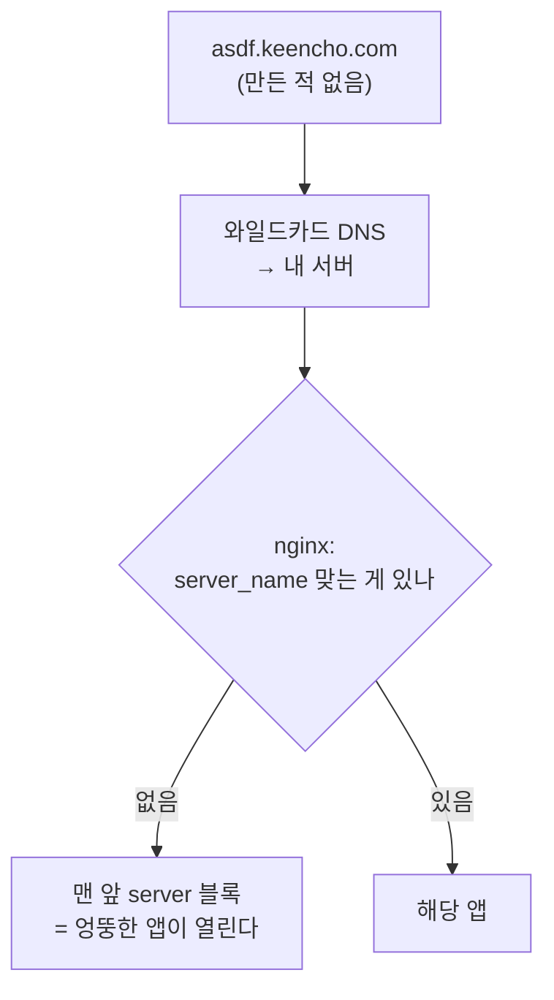

# **서브도메인을 미리 만들 수 없을 때**
어느 날 AWS 콘솔에 로그인했더니 주소가 바뀌어 있었다.

~~~
000000000000-aaaaaaaa.us-east-1.console.aws.amazon.com
   계정 번호     무작위 문자열
~~~

멀티세션을 켜면 이렇게 된다. 계정을 여러 개 동시에 열 수 있게 해주는 기능인데, 켜는 순간 주소 앞에 **계정 번호와 무작위 문자열**이 붙는다.

처음엔 그냥 그런가 보다 했는데, 생각해보니 이상했다. 저 무작위 문자열은 로그인할 때마다 새로 생긴다. 그럼 **저 주소는 DNS 에 어떻게 들어가 있는 걸까.** 미리 만들어둘 수가 없는데.

궁금해서 파보다가 내 서버에도 같은 구조를 적용하게 됐다. 그 과정에서 밟은 것들을 적는다.

## **왜 호스트를 가르나 - 쿠키 때문이다**
먼저 왜 주소를 가르는지부터. 답은 쿠키다.

브라우저 쿠키는 **호스트 단위로 갈린다.** 로그인 세션이 쿠키에 들어있으니, 호스트가 같으면 탭을 몇 개를 열든 **같은 세션**이다. 그래서 예전 콘솔에서는 한 브라우저로 계정 두 개에 동시에 로그인할 수 없었다. 한쪽에 로그인하면 다른 쪽이 밀려났다.

이걸 서버에서 풀려면 꽤 복잡해진다. 세션을 여러 개 들고 다니면서 어느 탭이 어느 세션인지 추적해야 한다. 그런데 **호스트를 다르게 주면 브라우저가 알아서 갈라준다.** 서버는 아무것도 안 해도 된다.

AWS 문서도 이걸 확인해준다 — 멀티세션 해제 방법이 "비활성화 누르기" 아니면 **"브라우저 쿠키 지우기"** 다. 상태가 쿠키에 있다는 뜻이다. 한 브라우저에서 동시에 최대 다섯 개까지 된다.

여기서 알아둘 게 하나 있다. 쿠키의 `Domain` 속성을 어떻게 주느냐로 범위가 갈린다.

| 설정 | 닿는 곳 |
|---|---|
| `Domain` 없음 (host-only) | **그 호스트에만** |
| `Domain=.example.com` | `example.com` 과 **그 아래 모든 서브도메인** |

부모 도메인에 걸면 서브도메인 전부가 그 쿠키를 받는다. 편해 보이지만 반대로 말하면 **서브도메인 하나가 뚫리면 전부 영향을 받는다.** GitHub Enterprise 가 사용자 업로드 콘텐츠를 별도 서브도메인으로 빼라고 권하는 것도 같은 이유다. 거기서 스크립트가 돌아도 본체 쿠키에 닿지 못하게.

그래서 **세션마다 다른 호스트**는 꽤 괜찮은 수다. 격리를 브라우저한테 떠넘기는 거다.

## **그 주소들은 DNS 에 없다**
그럼 처음 질문으로 돌아간다. 로그인할 때마다 새로 생기는 주소를 DNS 에 어떻게 넣나.

안 넣는다. **와일드카드 레코드 하나면 된다.**

~~~
*.us-east-1.console.aws.amazon.com    →    (같은 곳)
~~~

와일드카드 DNS 는 **그 아래 어떤 이름이든 같은 곳으로 보낸다.** 미리 등록할 필요가 없다. 이름이 뭐든 서버까지 오고, 그다음은 서버가 `Host` 헤더를 보고 판단한다.

단서가 하나 붙는다. 와일드카드는 **중간에 더 구체적인 이름이 없을 때만** 걸린다. `*.keencho.com` 을 걸어 뒀어도 `b.keencho.com` 레코드를 하나 만드는 순간, `a.b.keencho.com` 은 와일드카드로 안 간다. 가장 가까운 조상을 먼저 찾고 거기서 멈추지, 위로 더 올라가 다른 와일드카드를 찾지 않기 때문이다.

같은 꼴이 생각보다 흔하다.

- GitHub Codespaces — `{이름}-{무작위}-{포트}.app.github.dev`
- Vercel 프리뷰 — `{프로젝트}-{해시}.vercel.app`
- 사용자 콘텐츠 격리용 서브도메인

전부 **미리 만들 수 없는 이름**이라는 공통점이 있다. 세션마다, 커밋마다, 사용자마다 생긴다.

## **내 서버에도 해봤다**
원리를 알고 나니 직접 해보고 싶었다. 마침 개인 서버 한 대에 앱을 몇 개 올려둔 참이었다.

그때까지는 앱을 추가할 때마다 DNS 에 A 레코드를 하나씩 넣고 있었다. 귀찮았다. 앱 하나 올리려면 도메인 등록 업체에 들어가서 레코드를 만들고, 반영될 때까지 기다리고, 그다음에 nginx 를 고쳐야 했다.

와일드카드로 바꿨다.

~~~
*.keencho.com    A    (서버 IP)
~~~

이제 DNS 는 다시 안 건드린다. 새 앱을 붙일 때 nginx 설정만 추가하면 된다.

~~~nginx
server {
    server_name trip.keencho.com;

    location / {
        proxy_pass http://127.0.0.1:3100;
        proxy_set_header Host $host;
        proxy_set_header X-Forwarded-For $proxy_add_x_forwarded_for;
        proxy_set_header X-Forwarded-Proto $scheme;
    }
}
~~~

편했다. 그런데 며칠 뒤에 이상한 걸 발견했다.

## **안 만든 이름이 전부 들어왔다**
`asdf.keencho.com` 을 쳐봤다. **앱이 열렸다.**

만든 적 없는 주소인데 404 도 아니고 멀쩡히 열린다. 그것도 아무 앱이나가 아니라 **특정한 하나**가. 왜 그런지 찾아보니 nginx 동작이 그랬다.

nginx 는 요청이 들어오면 `Host` 헤더를 보고 맞는 `server` 블록을 찾는다. **맞는 게 없으면 거절하지 않는다.** 그 포트의 기본 서버로 보낸다. 그리고 기본 서버를 따로 지정하지 않았으면 **맨 처음 선언된 블록**이 기본이 된다.

와일드카드를 열기 전에는 이 일이 안 생겼다. DNS 에 없는 이름은 애초에 서버까지 오지 못했으니까. **와일드카드가 그 울타리를 없앴다.**

생각해보면 당연한 거래 관계다. "이름을 미리 안 만들어도 되게" 해달라고 했으니 **아무 이름이나 들어오는 것도 같이 받는다.** 이름을 거르는 일이 DNS 에서 서버로 넘어온 것뿐이다.

실제 피해로 이어질 수 있는 경로도 있다. 누가 `login.keencho.com` 같은 그럴듯한 이름으로 링크를 뿌리면 내 앱이 그 주소로 열린다. 로그 분석 도구가 호스트별로 집계하고 있으면 그것도 더러워진다.

## **막는 데 두 겹이 필요하다**
그래서 기본 서버를 따로 만들어 막았다.

~~~nginx
# 등록 안 된 호스트는 연결을 끊는다
server {
    listen 80  default_server;
    listen 443 ssl default_server;
    server_name _;

    ssl_reject_handshake on;   # 인증서 없이 TLS 거부
    return 444;                # 응답 없이 연결 끊기
}
~~~

`default_server` 로 지정하면 맞는 블록이 없을 때 **여기로** 온다. 맨 앞 블록이 아니라.

두 줄이 들어있는데, 처음엔 하나면 되지 않나 싶었다. 찾아보니 **둘 다 필요하다.**

`ssl_reject_handshake` 는 TLS 핸드셰이크 단계에서 `unrecognized_name` 으로 거절한다. 인증서를 안 들고 있어도 되는 게 장점이다(nginx 1.19.4 부터). 그런데 nginx 개발자 설명에 따르면 **이건 TLS 단계에서만 동작한다.** 핸드셰이크가 다른 server 블록에서 이미 끝난 뒤라면 HTTP 요청은 그대로 도달한다. HTTP/2 연결 재사용이나 도메인 프론팅이 그런 경우다.

그래서 HTTP 단계에서도 끊어야 한다. 그게 `return 444` 다. nginx 전용 코드로, **응답을 안 보내고 연결을 닫는다.** 403 이나 404 를 주면 "여기 서버가 있다" 는 정보는 주는 셈인데, 444 는 그것도 안 준다.

정리하면 **문 하나를 두 군데서 잠그는 것**이다. TLS 쪽과 HTTP 쪽. 한쪽만 잠그면 다른 길로 들어온다.

## **인증서는 한 단계만 덮는다**
HTTPS 를 붙이려니 여기서도 걸렸다.

와일드카드 인증서 `*.keencho.com` 을 받으면 다 될 줄 알았는데 아니었다. **와일드카드는 딱 한 단계만 덮는다.**

| 주소 | `*.keencho.com` 으로 되나 |
|---|---|
| `trip.keencho.com` | O |
| `keencho.com` | **X** (루트는 따로 적어야 한다) |
| `a.b.keencho.com` | **X** (두 단계는 안 덮는다) |

AWS 콘솔 주소를 다시 보면 `0000-aaaa.us-east-1.console.aws.amazon.com` 이다. 처음엔 무작위 부분이 `console.aws.amazon.com` 바로 아래 한 단계인 줄 알았는데, 세어 보니 **두 단계**였다. 그러면 `*.console.aws.amazon.com` 한 장으로는 못 덮는다. 궁금해서 찍어 봤다.

~~~console
$ nslookup zzzrandom.console.aws.amazon.com 8.8.8.8
*** Non-existent domain          # 여기엔 와일드카드가 없다

$ nslookup zzzrandom.us-east-1.console.aws.amazon.com 8.8.8.8
Aliases:  zzzrandom.us-east-1.console.aws.amazon.com
          wildcard.us-east-1.console.cname-proxy.amazon.com    # 이쪽은 받아 준다

$ openssl s_client -servername 0000-aaaa.us-east-1.console.aws.amazon.com     -connect us-east-1.console.aws.amazon.com:443 | openssl x509 -noout -subject -ext subjectAltName
subject=CN = *.us-east-1.console.aws.amazon.com
X509v3 Subject Alternative Name:
    DNS:*.us-east-1.console.aws.amazon.com, DNS:*.support.console.aws.amazon.com,
    DNS:*.lfr.console.aws.amazon.com, DNS:*.health.console.aws.amazon.com, ...
~~~

와일드카드가 `console.aws.amazon.com` 아래가 아니라 **리전 아래**에 있었다. 인증서도 리전이 박힌 와일드카드고, 한 장 안에 기능별 와일드카드가 여러 개 들어 있다.

그러니까 AWS 는 한 단계 제약에 맞춰 이름을 줄인 게 아니다. **두 단계로 가고 와일드카드를 더 받는 쪽**을 택했다. 제약이 설계를 바꾼 게 아니라 비용이 옮겨 간 거다.

그리고 와일드카드 인증서는 발급 방식이 다르다. 일반 인증서는 "그 주소로 파일을 놔두면 가져가서 확인" 하는 식인데(HTTP-01), 와일드카드는 **DNS 에 TXT 레코드를 넣어야 한다**(DNS-01). 자동 갱신하려면 DNS 업체 API 를 붙여야 하고, API 가 없는 업체면 갱신 때마다 손으로 넣어야 한다.

나는 앱이 몇 개 안 돼서 그냥 **도메인마다 따로 받기로** 했다. `certbot --nginx -d trip.keencho.com` 한 줄이면 끝이고 갱신도 알아서 된다. 와일드카드 인증서는 **이름을 미리 모를 때** 필요한 거지, 내 경우엔 앱 이름을 내가 정한다.

즉 **와일드카드 DNS 와 와일드카드 인증서는 따로 판단할 문제다.** DNS 는 와일드카드로 열어두고 인증서는 도메인별로 받는 조합이 가능하다. 나는 그 조합을 쓰고 있다.

## **여러 사람이 쓰면 하나 더 봐야 한다**
여기까지는 내 앱만 내가 올리는 경우다. 서브도메인을 **남이 가져가는** 구조면 하나 더 있다.

브라우저는 "같은 사이트" 를 판단할 때 공개 접미사 목록(Public Suffix List)을 본다. `example.com` 이 목록에 없으면 `a.example.com` 과 `b.example.com` 은 **같은 사이트**로 취급된다. 그러면 `a` 가 `Domain=.example.com` 으로 쿠키를 심을 수 있고, 그 쿠키가 `b` 에게 간다. 쿠키 토싱(cookie tossing)이라고 부른다.

멀티테넌트 서비스가 테넌트마다 서브도메인을 주는 구조라면 이게 실제 문제가 된다. 그래서 Vercel 같은 곳은 **테넌트 이름 바로 위 도메인을 공개 접미사 목록에 올리라고** 안내한다.

내 서버는 앱을 다 내가 올리니 해당이 없다. 다만 "서브도메인을 남에게 준다" 가 되는 순간 이 줄을 다시 읽어야 한다.

## **그런데 AWS 는 어떻게 만들었을까**
여기까지 쓰고 나니 궁금해졌다. 내가 nginx 로 한 걸 AWS 는 어떻게 했을까.

**찾아봤는데 안 나온다.** 엔지니어링 블로그도, 발표 자료도 없었다. 그래서 확인된 것과 아닌 것을 갈라 적는다.

**공식 문서에 있는 것**

- 주소 형식이 `{계정번호}-{무작위}.{리전}.console.aws.amazon.com` 이다
- 한 브라우저에서 **최대 다섯 개**
- opt-in 은 **브라우저 단위**이고, 해제 방법이 "비활성화 누르기" 또는 **"브라우저 쿠키 지우기"** 다

마지막 줄이 중요하다. **상태가 쿠키에 있다**는 걸 AWS 가 스스로 말한 셈이다. 이 글 앞부분의 추론이 여기서 멈춰도 되는 이유다.

**간접 단서**

멀티세션이 나온 뒤, AWS 콘솔에 대신 로그인해주는 서드파티 도구들이 깨졌다. 기존 로그아웃 리다이렉트를 거치면 400 이 나고 쿠키를 지워야 다시 되는 식이었다. **쿠키 스킴이 통째로 바뀌었다**는 뜻이다. 예전에 쓰던 `aws-userInfo` 쿠키도 대응물이 없다고 한다.

**모르는 것**

- 호스트를 **어디서** 가르는지. CDN 단인지, 로드밸런서인지, 아니면 그냥 앱이 `Host` 헤더를 읽는지
- 세션 상태를 어디에 두는지. 무작위 문자열과 실제 세션을 잇는 표가 어딘가 있을 텐데, 그게 무엇인지는 밖에서 알 길이 없다

여기서 내가 아는 척할 수 있는 건 **"리전 이름이 호스트에 들어있다"** 정도다. `us-east-1` 이 주소에 박혀 있으니 리전별로 가는 곳이 다르다는 건 확실하다.

**그럼 내가 만든다면.** 여기부터는 전부 추측이다. AWS 가 이렇게 했다는 게 아니라, 같은 걸 나보고 만들라면 어떻게 할까를 따라가본 것이다.

먼저 **무작위 문자열과 실제 세션을 잇는 표**가 필요하다. 쓰기는 로그인할 때 한 번, 읽기는 요청마다. 키 하나로 바로 찾고, 로그아웃이나 만료되면 알아서 사라져야 한다. **DynamoDB 가 딱 맞는 모양이다** — `{계정}-{무작위}` 를 키로 두고 TTL 을 걸면 끝이다. 관계형 DB 를 쓸 이유가 없다. 조인할 게 없으니까.

그다음이 진짜 질문이다. **호스트를 어디서 읽나.** 세 군데가 후보다.

| 어디 | 되나 |
|---|---|
| CloudFront Function | 네트워크를 못 탄다. 키 값 저장소를 붙이면 조회는 되지만 세션처럼 자주 바뀌는 데는 안 맞는다 |
| Lambda@Edge | 된다. 대신 요청마다 함수가 돌고 비싸다 |
| 앱이 `Host` 헤더를 읽는다 | 된다. 제일 단순하다 |

[엣지에서 처리하기 글]()에서 썼듯이 CloudFront Function 은 외부 호출을 아예 못 한다. 지금은 키 값 저장소를 붙여 엣지에서 조회하는 길이 생겼지만, 그쪽은 갱신이 잦은 데이터를 담으라고 만든 게 아니다. 세션 표는 로그인마다 쓰고 만료되면 지워져야 하니 결이 안 맞는다. Lambda@Edge 로 올리면 되는데, 콘솔 전체 요청에 함수를 하나 끼우는 건 비용이 만만치 않다.

**나라면 세 번째로 간다.** 그리고 여기서 생각이 한 번 뒤집혔다.

호스트를 가르는 목적이 **라우팅이 아니라 쿠키 격리**다. 그러면 **세션별로는 라우팅을 아무것도 안 해도 된다.** 리전 안에서 `*.{리전}.console.aws.amazon.com` 을 전부 같은 곳으로 보내고, 앱이 들어온 `Host` 에서 세션 키를 꺼내 쿠키와 대조하면 그만이다. 리전마다 와일드카드 레코드 하나, 그 리전 대상 그룹 하나.

내 서버 구조와 비교하면 차이가 분명하다. 나는 호스트마다 **다른 앱**으로 보내야 해서 nginx 가 갈랐다. 세션별 호스트는 **같은 앱**으로 가면 된다. 갈 곳이 하나면 가르는 장치도 필요 없다.

마지막으로 주소를 다시 보면 두 부분의 성격이 다르다는 게 보인다.

~~~
000000000000-aaaaaaaa . us-east-1 . console.aws.amazon.com
└──── 쿠키 가르기 ────┘  └ 라우팅 ┘
~~~

앞은 브라우저에게 "이건 다른 사이트야" 라고 말하는 용도고, 뒤는 **실제로 가는 곳이 다르다.** 리전이 다르면 백엔드가 다르니까. 한 주소 안에 성격이 다른 두 키가 들어있는 셈이다.

틀렸을 수도 있다. 다만 이렇게 따라가보면 **저 주소가 왜 저 순서로 생겼는지**는 설명이 된다.

그러니까 이 글에서 가져갈 건 **AWS 가 어떻게 만들었나가 아니라, 왜 저 모양일 수밖에 없나**다. 세션을 가르려면 호스트를 갈라야 하고, 호스트를 가르면 미리 등록할 수 없고, 그러면 와일드카드다. 거기까지는 구현을 몰라도 따라갈 수 있다.

**내 서버를 AWS 로 옮기는 건 반대로 간단하다.** nginx 의 `server_name` 분기는 ALB 의 호스트 기반 규칙이 대신한다. 리스너 규칙에 호스트 조건을 걸고 대상 그룹으로 보내는 것. 로드밸런서를 새로 만들 필요도 없이 기존 ALB 에 규칙 하나만 얹으면 되고, 와일드카드 인증서가 붙어 있으면 그것도 그대로 쓴다. 기본 서버 자리는 ALB 의 기본 작업이고, 거기에 고정 응답을 둔다.

다만 `return 444` 에 해당하는 건 없다. ALB 는 응답을 안 보내고 끊는 선택지를 안 준다. 그 자리는 404 든 403 이든 뭔가를 돌려주게 된다. **"맞는 규칙이 없을 때 무엇을 할지" 를 정해두는 건 어디서나 같고, 할 수 있는 선택만 조금씩 다르다.**

## **정리**
- 세션·커밋·사용자마다 다른 호스트를 주는 구조는 **쿠키를 가르려는 것**이다. 호스트가 같으면 브라우저가 세션을 하나로 본다. 격리를 서버가 아니라 브라우저에 떠넘기는 수다
- 쿠키 `Domain` 을 안 주면 그 호스트에만, 부모 도메인에 주면 **서브도메인 전부에** 닿는다. 하나가 뚫리면 전부 영향받는다
- 미리 만들 수 없는 이름은 **와일드카드 DNS** 로 받는다. 대신 **아무 이름이나 들어온다**는 걸 같이 받는 것이다
- nginx 는 `server_name` 이 안 맞으면 거절하지 않고 **기본 서버**로 보낸다. 지정 안 하면 맨 앞 블록이 기본이라, **엉뚱한 앱이 열린다**
- 막을 땐 **TLS 와 HTTP 두 군데**다. `ssl_reject_handshake` 는 TLS 단계만 막아서 HTTP/2 연결 재사용 같은 경로로 뚫린다. `return 444` 를 같이 둔다
- 와일드카드 인증서는 **한 단계만** 덮는다. 루트 도메인도, 두 단계 아래도 안 덮는다. 발급도 DNS-01 이라 손이 더 간다
- **와일드카드 DNS 와 와일드카드 인증서는 따로 판단한다.** 이름을 내가 정하면 DNS 만 와일드카드로 열고 인증서는 도메인별로 받는 게 편하다
- 서브도메인을 남에게 주는 구조면 **공개 접미사 목록**까지 봐야 한다. 안 올리면 테넌트끼리 쿠키가 넘나든다

콘솔 주소에 숫자가 붙은 게 거슬려서 들여다본 건데, 끝에 가서는 쿠키 범위 얘기였다. 주소를 가르는 쪽이 인증·세션 관리를 직접 짜는 것보다 훨씬 간단해서 그렇게들 만들어둔 것이고. 이상하게 생긴 주소를 보면 대개 그 모양이어야 하는 이유가 하나씩 있는 것 같다.
