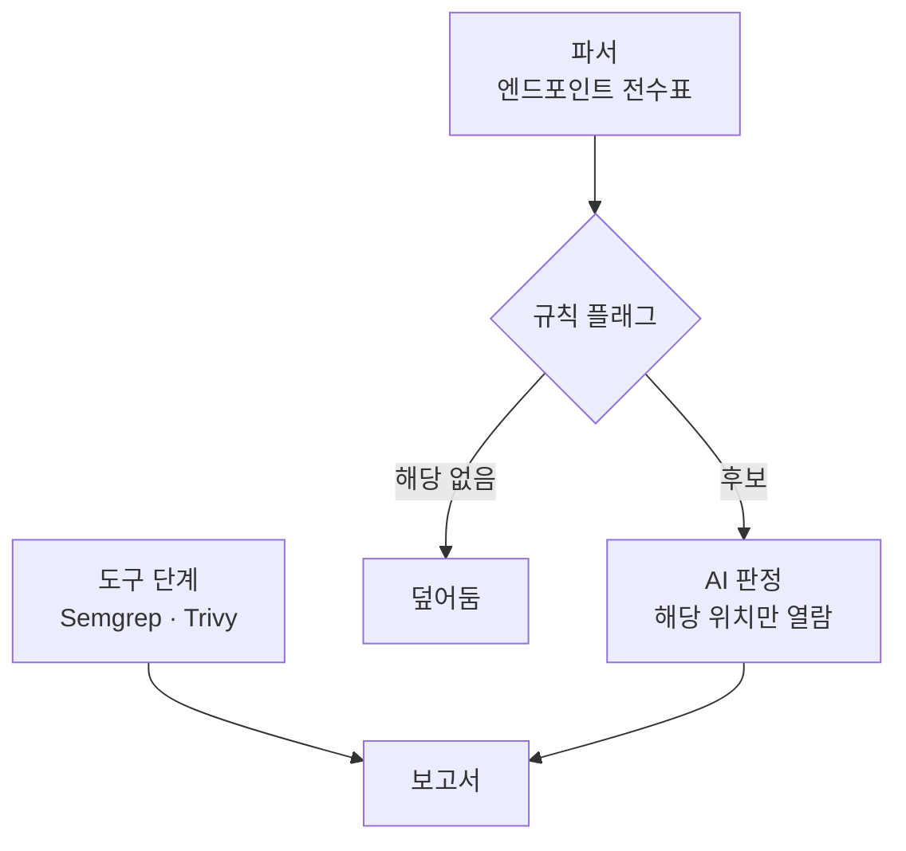

# **AI 가 볼 곳을 좁혀주기**
전사 소스 보안점검을 하게 됐다. 레포가 수십 개다.

Semgrep 과 Trivy 는 금방 붙였다. 규칙에 걸리는 패턴과 라이브러리 CVE 는 기계가 잘 찾는다. 문제는 그걸로 안 잡히는 것들이었다 — 인증 장치가 등록은 돼 있는데 실제로는 일부 API 만 검사한다든지, 남의 데이터를 ID 로 조회할 수 있다든지. 사람이 읽어야 아는 것들이다.

그래서 AI 보안 점검 도구를 돌려봤다. 에이전트들이 코드를 처음부터 읽으면서 의심 지점을 찾고, 후보마다 검증 에이전트가 붙어 투표하는 방식이다. 잘 찾는다. **그런데 레포 하나의 일부 코드만 보는 데 수천만 토큰을 썼다.** 레포 수십 개를 이렇게 돌릴 수는 없었다. 사용량 한도에 금방 닿았다.

미리 말해두면, **"도구가 후보를 만들고 LLM 이 판정한다" 는 발상 자체는 새롭지 않다.** 논문도 여럿 있고 Semgrep 에도 AI 트리아지가 기본 기능으로 들어 있다. 내가 한 건 그 패턴을 가져다가 **규칙으로는 안 잡히는 인가 문제**에 맞춰 쓴 것에 가깝다.

이 글은 그 과정의 기록이다. 회사 일로 만든 사내 플러그인이라 코드는 싣지 않는다. 접근 방식과 헛디딘 것들만 적는다.

## **토큰이 어디서 나가나**
토큰이 터지는 이유는 단순하다. **AI 가 "어디를 볼지" 부터 스스로 정하기 때문**이다.

코드베이스 전체를 훑으며 수상한 데를 고르고, 고른 것마다 맥락을 더 읽고, 그 후보를 다시 검증 에이전트 여럿이 읽는다. 찾는 일과 판단하는 일을 한 모델이 다 한다. 판단은 모델이 잘하는 일이 맞는데, **찾는 일까지 거기 얹은 게 문제인 거다.** 열어본 파일의 대부분은 아무 문제가 없고, 그걸 확인하는 데 토큰이 나간다.

그런데 "어디를 볼지" 중에 상당수는 **기계적으로 셀 수 있는 것**이었다. 이 서버에 API 가 몇 개 있고, 각각에 어떤 인증 어노테이션이 붙어 있고, 어떤 건 제외 경로에 올라가 있고, 어떤 건 ID 를 파라미터로 받는지. 전부 코드에 적혀 있다. 읽어서 표로 만들면 된다.

## **찾기는 스크립트, 판정만 AI**
그래서 역할을 갈랐다.

엔드포인트를 뽑아주는 도구는 이미 있다. OWASP Noir 는 프레임워크를 260종 넘게 읽어 경로·파라미터·헤더를 표로 만들어 주고, AI 에게 넘길 맥락을 붙이는 옵션까지 있다. 방향이 겹친다.

그걸 알고도 파서를 직접 쓴 이유는 하나다. **인가가 실제로 걸리는지에 대한 최종 판정은 아무도 대신 안 해준다.** 표를 아무리 잘 받아도 "이 주소가 로그인 없이 열려 있는가" 를 판정하고 그 결과로 빌드를 세우는 건 직접 붙여야 한다. 뒤에 붙일 규칙과 중단 장치를 어차피 만들어야 했고, 그러면 추출도 같이 쥐고 있는 쪽이 단순했다.

파서가 프레임워크별로 모든 진입점을 읽어 표를 만든다. 한 줄이 이렇게 생겼다.

~~~json
{ "method": "GET", "path": "/orders/{id}",
  "handler": "OrderController.get", "at": "OrderController.java:88",
  "auth": "AuthInterceptor",      // 어떤 인증 장치가 걸리는지
  "roles": [],                    // 역할 표시가 있는지
  "id_params": ["id"] }           // 남의 것을 조회할 수 있는 모양인지
~~~

그다음 규칙이 걸러낸다 — 인증 장치가 아예 없는 것, 제외 경로에 올라간 것, 역할 표시는 있는데 집행하는 코드가 없는 것, ID 로 조회하는데 소유자 조건이 안 보이는 것.

**AI 는 걸린 것만 연다.** 전수표 전체를 주지도 않는다. 후보의 해당 파일, 해당 줄 주변만 읽고 "진짜 문제인가" 를 판정한다. 그리고 오탐이라고 판정하면 **사유를 반드시 적게** 했다. 사유 없는 오탐 판정은 형식 검사에서 거절한다. 그게 없으면 모델이 "문제없음" 으로 조용히 넘기는 쪽으로 기운다.

결과는 이랬다. 범위를 훨씬 넓혀 돌렸는데도 **토큰이 자릿수 하나만큼 줄었다.**

찾아낸 것도 줄지 않았다. 앞서 손으로 점검해 알고 있던 것을 빠짐없이 다시 잡았고, 손 점검이 놓친 것도 몇 개 더 나왔다.

## **파서가 똑똑해지려다 API 수백 개를 뒤집었다**
여기까지는 깔끔한데, 실제로는 여기서부터 헤맸다.

인증 인터셉터를 `/**` 에 걸어 두고 어노테이션으로 분기하는 구성이 있다. 흔한 모양이다. 파서는 "등록됨 = 전부 인증" 으로 본다. 그런데 그 인터셉터가 **특정 어노테이션이 붙은 핸들러만** 검사하는 식이면 나머지는 그냥 통과한다. 파서가 놓치고 AI 판정이 대신 잡는 자리다.

그래서 파서를 고쳤다. "장치가 어노테이션을 찾는 코드면, 그 어노테이션이 붙은 API 만 인증된 것으로 본다." 그럴듯했다.

다른 서버에서 터졌다. 거기엔 **붙으면 검사를 면제하는** 어노테이션이 있었다. 이름만 봐서는 구분이 안 된다. 파서는 그걸 "붙어야 인증" 으로 읽었고, **멀쩡한 API 수백 개가 전부 무인증으로 뒤집혔다.**

정규식으로는 이 둘을 구분할 수 없다. 장치 코드를 읽고 "이 조건이 참이면 통과시킨다" 를 이해해야 하는데, 그건 파싱이 아니라 독해다. 되돌렸다.

그 무렵 앱 하나 돌릴 때마다 파서를 고치고 있었다. 프레임워크가 다르고, 같은 프레임워크여도 앱마다 인증을 거는 방식이 달랐다. **이럴 거면 뭐하러 스크립트를 쓰나** 싶었다. AI 한테 다 맡기면 이런 걸 안 해도 되는데.

정리하고 나니 선이 하나 그어졌다.

| 상황 | 할 일 |
|---|---|
| 파서가 **못 읽는 형태** | 파서를 고친다. 형태별로 한 번이면 끝난다 |
| 파서 판정이 **틀린 경우** | 파서를 고치지 **않는다.** AI 쪽으로 넘긴다 |

**파서는 목록만 만든다. 의미 판정은 AI 가 한다.** 못 읽는 건 문법 문제라 한 번 고치면 그 형태 전부에 통한다. 반면 "이 장치가 실제로 인증을 거는가" 는 의미 문제라 앱마다 다르고, 고칠 때마다 다른 데가 터진다.

그 어노테이션도 이렇게 처리했다. 엔드포인트마다 묻는 대신 **장치 하나당 질문 한 건**을 AI 에 넘긴다.

~~~text
이 앱의 인증 장치는 특정 어노테이션 유무로 동작이 갈린다.
붙으면 검사인가, 면제인가?

  (장치 코드)

영향받는 API 수: 180여 개   예시: GET /orders/{id}, POST /orders ...

→ {"mode": "require|exempt", "reason": "40자 이내"}
~~~

AI 가 장치 코드를 읽고 답한다. 질문이 앱당 한 건이라 비용이 거의 안 든다.

## **빠뜨리느니 멈춘다**
파서가 못 읽는 코드를 만나면 어떻게 할까. 처음엔 건너뛰고 나머지를 계속 처리했다.

그게 제일 위험했다. 못 읽은 파일은 보고서에 **아예 안 나온다.** 점검 안 한 곳과 점검해서 문제없는 곳이 화면에서 똑같아 보인다. 100개 중 97개만 보고 "다 봤다" 고 착각하는 상태가 된다.

그래서 엄격 모드로 바꿨다. 진입점 표시는 있는데 파싱한 개수가 안 맞으면 **거기서 멈춘다.** 사유를 보여주고 사람이 고르게 한다 — 파서를 고칠지, 그 경로를 제외할지, 알고도 넘어갈지.

이건 파서 전반의 원칙이 됐다. 경로가 상수로 조립돼 있으면(`BASE + "/x"`) 풀어서 쓰고, 못 풀면 오류를 낸다. **추측해서 채우지 않는다.** 점검 도구에서 "아마 이럴 것이다" 는 안 하느니만 못하다.

## **정규식이 느렸던 이유**
파싱이 느려서 들여다본 적이 있다. 처음엔 백트래킹을 의심했는데 아니었다.

~~~python
# 고치기 전 — 앵커가 없다
re.finditer(r'[\w<>,. ]+?\s+(\w+)\(', src)

# 고친 뒤 — 줄 머리에서만 시작하게
re.finditer(r'^[\w<>,. ]+?\s+(\w+)\(', src, re.M)
~~~

자바 메서드 선언을 잡으려던 건데, 이 패턴에는 중첩 수량자가 없어서 사실 폭발할 구석이 없다. 진짜 이유는 **시작점을 안 정해준 것**이었다. 앵커가 없으니 엔진이 파일의 모든 위치에서 매칭을 다시 시도한다. 선언이 나올 수 있는 자리는 줄 머리뿐인데도 그렇다.

`^` 를 붙이고 `re.M` 을 켜서 시작점을 줄 머리로 한정했다. `re.M` 혼자서는 아무것도 안 줄여준다 — `^` 가 각 줄 머리에서도 먹히게 해주는 짝일 뿐이다. 같은 파일을 여러 규칙이 각자 훑던 것도 한 번만 색인하게 고쳤다. 정규식 자체가 아니라 **어디서부터 찾게 할 것인가**가 문제였다.

괄호도 비슷했다. `@Operation(responses = {@ApiResponse(...)})` 처럼 중첩되면 정규식으로는 못 센다. 짝을 세는 작은 함수로 바꿨다. 주석 안의 코드도 먼저 지운다 — 줄 번호는 유지한 채로.

## **일부러 병렬로 안 돌린다**
레포를 여러 개 지정해도 한 번에 하나씩 순서대로 돈다. 레포 안에서 AI 판정은 이미 하위 에이전트 네 개까지 병렬인데, 레포끼리는 아니다.

처음엔 당연히 병렬이 낫다고 생각했다. 따져보니 아니었다.

- **토큰 총량은 안 줄어든다.** 같은 양이 짧은 시간에 몰릴 뿐이고, 그러면 5시간 사용 한도에 더 빨리 닿는다
- 8개 순차가 15~30분이다. 병렬로 묶어도 디스크가 막혀 10분 안쪽으로는 안 내려갈 텐데, 그래 봐야 **아끼는 게 5~20분**이다
- Semgrep·Trivy·lock 생성은 **디스크를 많이 쓴다.** 하드디스크 작업 PC 에서 동시에 돌리면 서로 막혀 오히려 느려질 수 있다
- 레포 병렬 × 레포당 4개면 동시 에이전트가 수십 개다. 실패 처리와 진행 표시가 복잡해진다

정말 동시에 돌려야 하면 Claude Code 세션을 두 개 열면 된다. 기능으로 만들 이유가 없었다.

대신 다른 걸 봐야 한다는 건 알게 됐다. 한 세션에서 레포를 연달아 돌리면 대화가 길어지고, **뒤 레포일수록 세션 쪽 토큰이 는다.** 이게 커지면 병렬보다 먼저 손볼 건 "도구 단계를 전부 먼저 돌리고 판정만 이어서" 쪽이다.

## **못 잡는 것**
이 방식의 대가는 분명하다. **규칙으로 표현할 수 있는 것만 AI 에게 간다.**

규칙을 못 만든 유형은 AI 가 아예 안 본다. 한 줄이 잘못된 게 아니라 **설계가 그런 경우**가 특히 그렇다. 엔드포인트 하나하나는 인증도 걸려 있고 소유자 조건도 있는데, 여러 엔드포인트를 가로질러 봐야 비로소 어긋나는 종류다. 표를 아무리 잘 만들어도 그 표에 안 나타난다.

이런 건 규칙으로 못 잡으니 **체크리스트 질문으로 넘겼다.** OWASP 가 정리해 둔 유형 중에 표로는 안 드러나는 것들을 골라 매번 묻게 했다. 규칙이 못 하는 자리를 질문이 메우는 식이다.

오탐도 적지 않았다. 한 서버에서 후보 백여 건 중 절반쯤이 조치 대상이었고 나머지가 오탐이었다. 절반 가까이가 헛걸음인 셈인데, **이건 의도한 비율**이다. 규칙을 느슨하게 걸어 후보를 넉넉히 만들고 판정에서 거른다. 반대로 하면 놓친다. 오탐 사유를 남기게 한 것도 그래서다 — 사유가 쌓이면 규칙을 어디서 조일지 보인다.

## **정리**
- 후보를 도구가 만들고 LLM 이 판정하는 구조는 이미 흔하다. 엔드포인트 추출기도 AI 에게 맥락을 넘기는 쪽으로 가고 있다. 다만 **인가가 걸렸는지에 대한 최종 판정과 중단은** 직접 붙여야 한다
- AI 가 코드를 처음부터 읽으며 **찾는 일까지 하면** 토큰이 거기서 나간다. 열어본 것의 대부분은 문제없는 코드다
- **찾기는 스크립트, 판정만 AI.** 진입점·인증 장치·ID 파라미터는 코드에 적혀 있으니 세면 된다. 같은 대상에서 토큰이 자릿수 하나만큼 줄었고 범위는 오히려 더 넓었다
- **파서는 목록만 만든다.** "인증이 실제로 걸리는가" 를 스크립트가 확정하려 들면 앱마다 터진다. 어노테이션 하나를 반대로 읽어 멀쩡한 API 수백 개를 무인증으로 뒤집었다
- 못 읽는 형태는 파서를 고치고, 의미를 잘못 읽은 건 AI 로 넘긴다. **문법 문제와 독해 문제를 갈라야** 고칠 곳이 정해진다
- 못 읽으면 **멈춘다.** 말없이 건너뛰면 점검 안 한 곳이 보고서에서 안 보인다. 추측해서 채우지 않는다
- 병렬은 토큰 총량을 안 줄인다. **짧은 시간에 몰려 한도에 빨리 닿을 뿐**이다
- 규칙으로 표현 못 하는 유형은 AI 가 아예 안 본다. 그 자리는 **체크리스트 질문**으로 메운다
- 오탐은 넉넉히 받는다. 대신 **오탐 사유를 반드시 남기게** 해서 규칙을 조일 자리를 찾는다

모델이 잘하는 건 읽고 판단하는 쪽이고, 어디를 읽을지 고르는 건 대체로 기계적인 일이다. 그 둘을 안 가르면 비싼 쪽이 싼 일까지 하게 된다. 파서가 똑똑해지려다 수백 개를 뒤집은 건 같은 실수를 반대로 한 거고 — 싼 쪽이 비싼 일을 하려 들었다. 지금도 규칙을 하나 더 쓸지 질문으로 넘길지를 매번 다시 따진다.
